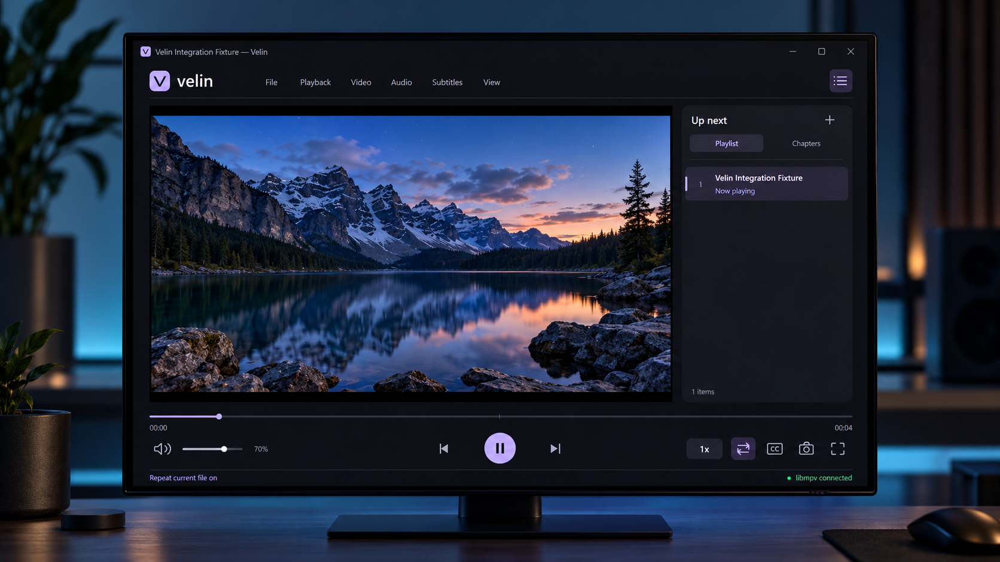

# Velin

A native Windows media player in modern C++20, porting IINA's playback model
and essential player experience to Windows. The interface uses Win32,
Direct2D, and DirectWrite; libmpv handles media playback.



This repository contains the 0.2.0 Windows development implementation. It does not
yet implement every IINA feature. See [the porting notes](docs/PORTING.md) for
architecture and remaining parity work.

## Build and run

Requirements:

- 64-bit Windows 10 version 1703 or newer, or Windows 11.
- CMake 3.24 or newer.
- Visual Studio 2022 with the Desktop development with C++ workload, or
  MinGW-w64 with C++20 support and Ninja.
- 7-Zip for the optional runtime download script.

Run these commands in PowerShell from the repository root:

```powershell
powershell -NoProfile -ExecutionPolicy Bypass -File .\scripts\Get-Mpv.ps1
./scripts/Get-Helpers.ps1
./scripts/Get-WebView2.ps1
cmake --preset msvc-release
cmake --build --preset msvc-release --parallel
ctest --preset msvc-release
.\build\msvc-release\Release\velin.exe
```

For MinGW-w64, put `g++`, `ninja`, and `cmake` on `PATH`, then use:

```powershell
cmake --preset mingw-release
cmake --build --preset mingw-release --parallel
ctest --preset mingw-release
.\build\mingw-release\velin.exe
```

On macOS, the engine, platform services, extension host and their tests
build without the Windows player. This is the groundwork for an iOS edition.
It needs Xcode, CMake and Ninja (`brew install cmake ninja`):

```sh
cmake --preset macos-release
cmake --build --preset macos-release --parallel
ctest --preset macos-release
```

The application can also open media passed on its command line:

```powershell
.\build\mingw-release\velin.exe "C:\Videos\Film.mkv" "C:\Videos\Next.mp4"
.\build\mingw-release\velin.exe "https://example.com/video.mp4"
```

`velin-cli` and single-instance forwarding resolve relative media paths against
the launching process's working directory. Use `--` before a media name that
begins with `--` to prevent it from being interpreted as an option.

The runtime script downloads one pinned baseline x64 libmpv build, checks the
archive and DLL against the SHA256 values in
[config/mpv-runtime.json](config/mpv-runtime.json), and writes only inside this
repository. CMake copies `runtime/libmpv-2.dll` beside the executable. It does
not install codecs, services, or anything globally. Pass `-SevenZipPath` to
the script if 7-Zip is installed outside its usual location.

Alternatively, supply your own compatible 64-bit libmpv runtime:

```powershell
cmake --preset mingw-release -DVELIN_MPV_DLL=C:/path/to/libmpv-2.dll
cmake --build --preset mingw-release
```

The DLL must expose libmpv client API major version 2. Velin loads
`libmpv-2.dll` or `mpv-2.dll` from its executable directory. The application can
compile without the DLL; playback needs the DLL present. Direct HTTP(S)
media streams are supported by the runtime. A site such as YouTube may need
additional extraction support; yt-dlp is acquired by Get-Helpers.ps1 for complete release packages.

## Player capabilities

- Open local media, multiple files, folders, and direct media URLs.
- Drag media into the window and manage a playlist.
- Play, pause, stop, seek, change volume, mute, and adjust playback speed.
- Choose audio and subtitle tracks and load external subtitle files.
- Browse chapters, step frames, and control playback from the keyboard.
- Switch fullscreen, keep the window on top, and use a compact player layout.
- Hide the controls automatically during fullscreen video and show a disc view for audio-only media.
- Remember recent media, window size, playback preferences, and resume position.
- Decode with libmpv's hardware acceleration and software fallback.

Use the application's menus to discover commands and keyboard shortcuts.
The interface and application messages currently use English.

| Shortcut | Action |
| --- | --- |
| `Ctrl+O`, `Ctrl+Shift+O`, `Ctrl+L` | Open files, a folder, or a media URL |
| `Space` | Play or pause |
| `Left`, `Right` | Seek backward or forward 5 seconds |
| `Up`, `Down` | Increase or decrease volume by 5 |
| `Shift+Left`, `Shift+Right` | Previous or next playlist entry |
| `Page Up`, `Page Down` | Previous or next chapter |
| `[`, `]`, `Backspace` | Decrease speed, increase speed, or reset to 1x |
| `M`, `J`, `K` | Toggle mute, cycle subtitles, or cycle audio |
| `F`, `Alt+Enter` | Toggle fullscreen |
| `Ctrl+M`, `T` | Toggle compact mode or always on top |
| `S`, `R`, `L` | Screenshot, repeat the current file, or set A-B loop points |
| `Ctrl+Shift+S` | Load an external subtitle file |
| `Ctrl+I`, `?` | Media information or shortcut help |

In Preferences > Keys, add one override per line, for example `F2=open-files`
or `Space=disabled`. Existing shortcuts remain active unless their key is
overridden; remove an override to restore its default. Duplicate keys are
rejected. Supported keys are letters, digits, F1–F24, the navigation keys, and
period, comma, brackets, semicolon, slash, apostrophe, backslash, grave accent,
and minus, optionally with Ctrl and/or Shift. Alt,
Windows, and mouse bindings are not supported by this editor. Commands include
`open-files`, `open-folder`, `open-url`, `play-pause`, `stop`, `next`, `previous`,
`fullscreen`, `pip`, `music-mode`, `playlist`, `preferences`, `history`,
`screenshot`, `mute`, `crop`, `inspector`, `online-subtitles`, `plugins`,
`quit`, `add-subtitles`, `save-playlist`, `shuffle`, `zoom-in`, and `zoom-out`.
Other entries are sent as mpv commands; prefix `mpv:` to make this explicit.
Built-in application commands can also be prefixed with `velin:`.

Preferences are saved in `%LOCALAPPDATA%\Velin\preferences.ini`. Resume data
is maintained by libmpv under `%LOCALAPPDATA%\Velin\mpv\watch_later`.
Deleting the Velin application-data directory resets local preferences and
history.
Set `VELIN_DATA_DIR` to an absolute directory to keep application data in a
different location. For example, scope it to one PowerShell session:

```powershell
$env:VELIN_DATA_DIR = Join-Path (Get-Location) '.cache\app-data'
.\build\mingw-release\velin.exe
```

The playback smoke script uses an isolated directory under `.cache` so test
runs do not change the normal player's preferences or resume data.

## Testing

`ctest` exercises the portable core: time formatting, Unicode conversion,
media path handling, directory expansion, and preferences persistence. The
Windows engine smoke executable is explicitly skipped in the default CTest
run because it requires libmpv and media fixtures. Its runtime mode exercises
the actual dynamically loaded playback engine with generated media fixtures.
With FFmpeg on `PATH`, generate those fixtures and run the smoke validation:

```powershell
powershell -NoProfile -ExecutionPolicy Bypass -File .\scripts\Test-Playback.ps1 -BuildDirectory build/mingw-release -Headless
```

Omit `-Headless` to exercise GPU video output and capture a decoded frame.
The test keeps audio output silent while decoding audio. The fixtures include
a Unicode filename, video, audio, chapters, a second playlist
entry, and an external subtitle. This test uses only locally generated media.

The native GUI smoke script runs 34 checks covering the welcome screen,
embedded playback window, playlist, fullscreen, compact layout, saved
preferences, and missing-runtime recovery:

```powershell
powershell -NoProfile -ExecutionPolicy Bypass -File .\scripts\Test-Gui.ps1 -Executable build/mingw-release/velin.exe -MediaPath C:\path\to\video.mkv
```

The GUI script launches its own test instances, isolates their application data,
captures those player windows at physical DPI, and closes the instances it
created. Captures and reports are saved under `.cache/gui-smoke`.

The core can be built independently of the Windows player:

```powershell
cmake -S . -B build/core -G Ninja -DVELIN_BUILD_PLAYER=OFF
cmake --build build/core
ctest --test-dir build/core --output-on-failure
```

## Packaging

After building and acquiring the pinned runtimes and NSIS tool, create the
portable ZIP, NSIS installer and corresponding application source ZIP:

```powershell
./scripts/Package-Release.ps1 -BuildDirectory build/msvc-release
```

Outputs are written to `build/msvc-release/artifacts`, separately from MSVC's
`Release` binary directory. The script also produces SHA256SUMS, releases.json
and signing reports. Without a configured signing identity the artifacts are
unsigned. No public download URL is inferred; pass ReleaseBaseUrl when publishing
to an actual release endpoint. Older 0.1 archives are stale.

Binary distributors must also provide the applicable corresponding source and
notices for the libmpv build and its dependencies; the Velin source archive does
not include that third-party source tree.

See [plugin compatibility](docs/PLUGIN_COMPATIBILITY.md) for audited Windows API
behavior, supported encodings, process output restrictions and input differences.

## License and attribution

Velin is GPL-3.0-or-later. The original reference is
[IINA](https://github.com/iina/iina), commit
`1b05edd0f7524ecc95286af75529007d4cfe1124`, distributed under GPLv3.
This project is an independent Windows port and does not imply endorsement
by the IINA or mpv projects.

See [LICENSE](LICENSE) and [THIRD_PARTY_NOTICES.md](THIRD_PARTY_NOTICES.md).

Current verification and remaining compatibility boundaries are tracked in
[implementation status](docs/IMPLEMENTATION_STATUS.md). Run
`./scripts/Test-Update.ps1` for isolated updater and rollback regressions, and
`./scripts/Test-OwnedShortcuts.ps1` for installer shortcut creation and ownership checks.
These fixtures do not replace an installer lifecycle test in an isolated Windows
environment.
